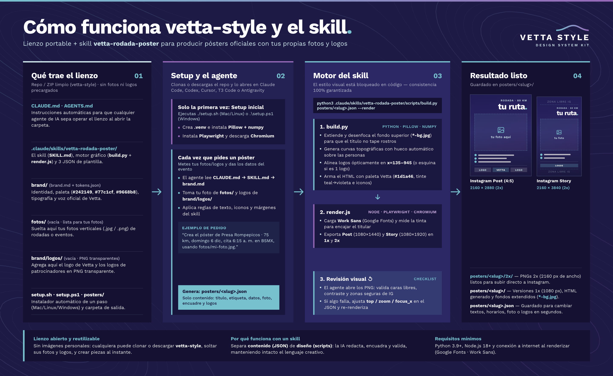

# Vetta Style

Lienzo creativo listo para descargar, agregar tus propias fotos y logos, y continuar produciendo pósters de rodadas y contenido de **Vetta Pro Cycling** con el mismo diseño y lenguaje visual aprobado — genera automáticamente **Instagram Post** (`1080×1440` + `2x`) e **Instagram Story** (`1080×1920` + `2x`) usando tu agente de IA favorito (Claude Code, Codex, Cursor, T3 Code, Antigravity, etc.).

> Este repositorio funciona como **lienzo en blanco**: no incluye fotografías ni logos binarios. Solo suelta tus fotos en `fotos/` y tus logos PNG transparentes en `brand/logos/` para empezar a generar piezas.

---

## Paso a paso rápido (3 minutos)

1. **Clona o descarga** este repositorio (`Code → Download ZIP` o `git clone`).
2. **Abre la carpeta `vetta-style`** en tu agente de IA.
3. **Solo la primera vez**, dile al agente *"corre el setup inicial"* (o ejecuta `./setup.sh` en macOS/Linux o `.\setup.ps1` en Windows). Requiere **Python 3.9+** y **Node.js 18+**.
4. **Agrega tus recursos visuales:**
   - Suelta tus fotos (`.jpg` / `.png`) dentro de `fotos/`.
   - Suelta tus logos en PNG transparente (versión blanca preferentemente) dentro de `brand/logos/`.
5. **Pídele el póster al agente** con los datos de tu evento (ver ejemplos abajo).

---

## Qué trae este lienzo

| Carpeta / Archivo | Para qué sirve |
|---|---|
| `.claude/skills/vetta-rodada-poster/` | Skill (`SKILL.md`), motor de diseño (`build.py`, `render.js`) y 3 JSON de plantilla. |
| `CLAUDE.md` y `AGENTS.md` | Instrucciones automáticas para que cualquier agente de IA sepa operar el lienzo. |
| `brand/brand.md` y `brand/tokens.json` | Guía de marca, paleta oficial (`#242149`, `#77c1cf`, `#9668b8`, `#f2f3ef`), tipografía, tono y canales. |
| `brand/logos/` | Carpeta vacía lista para tus logos en PNG transparente (Vetta y patrocinadores). |
| `fotos/` | Carpeta vacía lista para tus fotos de rodadas y eventos. |
| `posters/` | Aquí guarda el agente el JSON y los PNG finales de cada pieza que genere. |
| `setup.sh` / `setup.ps1` | Instalador de un paso (Pillow, numpy, Playwright y Chromium). |
| `docs/como-funciona-vetta-style.png` | Diagrama visual de cómo funciona el kit y el skill. |

---

## Ejemplos de qué pedirle al agente

### Opción A — Rodada con fecha, horarios y patrocinadores
> *"Usa el skill `vetta-rodada-poster` para crear el póster de esta rodada:*
> *- Título: Presa Rompepicos*
> *- Etiqueta: Rodada grupal · 75 km*
> *- Fecha: domingo 6 de diciembre*
> *- Horarios: cita 6:15 a. m. · salida 6:30 a. m.*
> *- Punto de salida: desde BSMX*
> *- Ruta: BSMX - Rompepicos*
> *- Nivel: intermedio y avanzado*
> *- Foto: `fotos/mi-foto.jpg`*
> *- Logos: `brand/logos/bsmx-logo-white.png`, `brand/logos/vetta-logo-white.png`, `brand/logos/rusela-logo-white.png`"*

### Opción B — Póster de comunidad o entrenamiento (solo logo Vetta)
> *"Usa `vetta-rodada-poster` para crear un póster de entrenamiento personalizado con `fotos/mi-foto.jpg` y solo el logo de Vetta."*

---

## ¿Qué archivos se publican en Instagram?

Cada pieza queda en `posters/<nombre>/`:
- `posters/<nombre>/2x/<nombre>-post.png` — **Post listo para publicar (`2160×2880`)**
- `posters/<nombre>/2x/<nombre>-story.png` — **Story lista para publicar (`2160×3840`)**
- También se guardan las versiones `1x` y `posters/<nombre>.json` para ajustar textos, horarios, encuadre o fotos en segundos.

## Notas rápidas
- Los logos van **sin divisores verticales** por defecto (si algún evento los necesita, activa `"separators": true`).
- Si un logo solo existe en versión oscura, agrega `"force_white": true` en el JSON.
- Se requiere conexión a internet al renderizar para cargar `Work Sans` desde Google Fonts.
